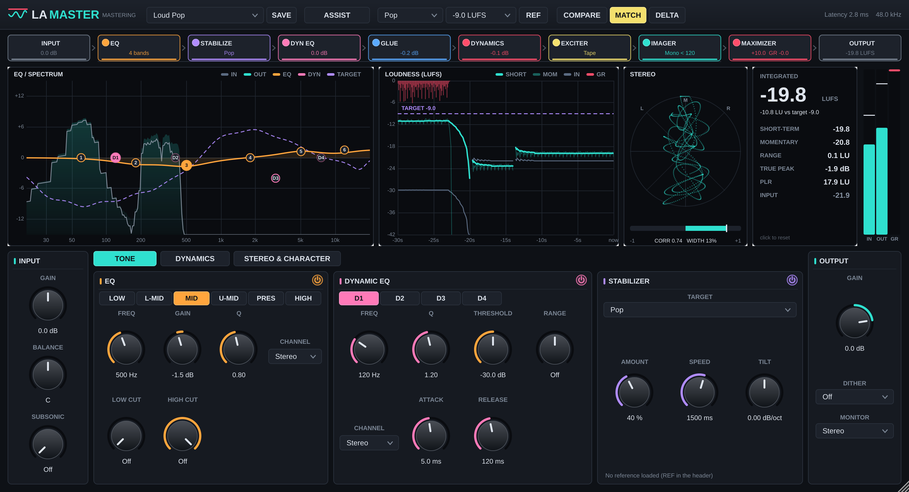
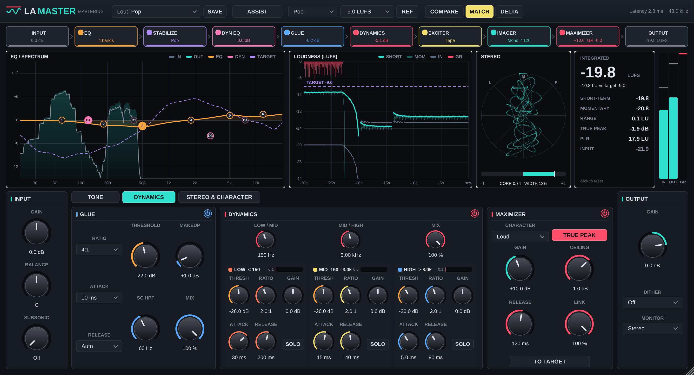
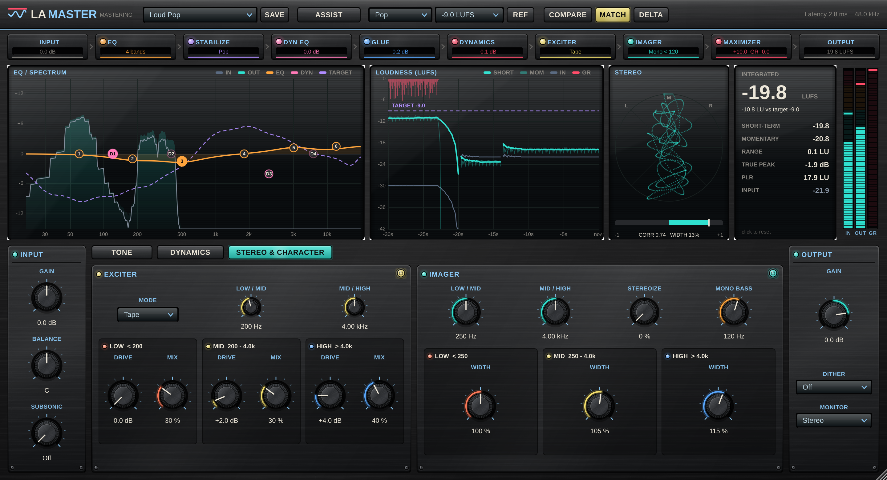

# LA-Master

An all-in-one mastering chain for Linux (VST3 / LV2 / Standalone), in the spirit of iZotope Ozone:
EQ, adaptive tonal balance, dynamic EQ, bus "glue" compression, multiband dynamics, a multiband exciter,
a stereo imager and a true-peak maximizer. It also has EBU R128 loudness metering, a Master Assistant,
reference-track matching, gain-matched A/B, and dither. It uses the same look as LA-Trigger, LA-VocalChain
and LA-AmpSuite.



| Dynamics page | Stereo & Character page |
|---|---|
|  |  |

## Signal flow

```
INPUT -> [ EQ  STABILIZE  DYN EQ  GLUE  DYNAMICS  EXCITER  IMAGER ] -> MAXIMIZER -> OUTPUT (gain, dither)
          \__________ drag to reorder in the chain strip __________/
```

Each stage is a tile in the chain strip. Click a tile's dot to switch the stage on or off. Click the tile to
open its controls. Drag the module tiles to change their order. The order is saved with the session and in
presets. The Maximizer is always last.

## Features

| Stage | What it does |
|---|---|
| **Input** | Gain, balance, and a 24 dB/oct subsonic filter. |
| **EQ** | 6 bands: low shelf, 4 bells and a high shelf. Each band works on Stereo, **Mid** or **Side**. Also 24 dB/oct low and high cuts. Drag the numbered nodes on the spectrum, use the mouse wheel for Q, and double-click a node to reset it. |
| **Stabilizer** | Adaptive tonal balance. It measures the mix in 10 octave bands and steers it towards a target curve (Balanced, Pop, EDM, Hip-Hop, Rock, Acoustic, Orchestral, Lo-Fi, or a **reference track**). Controls are *Amount*, *Speed* and *Tilt*. Its live correction is drawn on the spectrum. |
| **Dynamic EQ** | 4 bands that cut (or boost) only while their frequency range is above a threshold, for harsh peaks, boomy notes or sibilance. Stereo / Mid / Side per band. They are the pink **D** nodes on the spectrum, with their live gain shaded. |
| **Glue** | Stereo-linked VCA bus compressor with stepped ratio (1.5, 2, 4, 10:1), attack and release (including **Auto** release), a side-chain high-pass, makeup and mix. |
| **Dynamics** | 3-band compressor with Linkwitz-Riley crossovers. Per band: threshold, ratio, attack, release, gain and **solo**, with a gain-reduction bar. Also a parallel mix. |
| **Exciter** | 3-band harmonic exciter at 2x oversampling. Modes: Tape, Tube, Warm, Triode, Retro. Per band: drive and mix. |
| **Imager** | 3-band stereo width (0–200 %), a mono-compatible **Stereoize**, and phase-coherent **Mono Bass** below a chosen frequency. |
| **Maximizer** | Look-ahead brickwall limiter with **true-peak** detection (4x interpolation). Characters: Transparent, Balanced, Loud (soft-clips peaks first) and Clip (drives an oversampled clipper). Controls are gain, ceiling, release and stereo link. **TO TARGET** sets the gain from the measured loudness. |
| **Output** | Gain, **dither** (24-bit, 16-bit TPDF, 16-bit noise-shaped) and monitoring (Stereo, Mono, Side, Left, Right). |
| **Master Assistant** | Press **ASSIST**, play the loudest part of the song for 10–30 seconds, then press it again. It runs on a background thread. It sets input gain staging, broad EQ moves towards the target, the Stabilizer, Glue, multiband thresholds and mono bass. It then renders the audio through the new chain to find the Maximizer gain that meets the **target loudness** at −1 dBTP. |
| **Targets** | Target style (header) and target loudness: −23 (broadcast), −16 (Apple Music / podcast), −14 (Spotify / YouTube), −11, −9, −7 LUFS, or a custom value. |
| **Reference** | **REF** loads a WAV / AIFF / FLAC / OGG / MP3. Its tonal balance becomes the *Reference* target and its loudness becomes the target loudness. It is saved with the session. |
| **Compare** | **COMPARE** plays the latency-aligned input. With **MATCH** on, it plays at the master's loudness, so you judge tone and dynamics rather than volume. **DELTA** plays only what the chain changes. |
| **Metering** | Spectrum (input, output, EQ, dynamic EQ, target curve). Loudness history (momentary, short-term, input, maximizer gain reduction, target). Vectorscope with correlation and width. Integrated / short-term / momentary LUFS, loudness range, true-peak max and PLR (click to reset). IN/OUT/GR meters, and live values on every chain tile. |
| **Presets** | 15 factory presets: Streaming Balanced, Loud Pop, EDM Club, Hip-Hop Punch, Rock Energy, Acoustic Natural, Orchestral Dynamic, Lo-Fi Warm, Podcast / Spoken Word, Gentle Glue, Wide & Bright, Vinyl Pre-Master, Bass Control, Limiter Only, and Default. **SAVE** stores user presets in `~/.config/LA Audio/LA-Master/Presets`. |

### Compared with Ozone and similar suites

| Ozone module / feature | LA-Master |
|---|---|
| Equalizer (M/S per band) | EQ |
| Dynamic EQ | Dynamic EQ |
| Stabilizer / Tonal Balance Control | Stabilizer + target curve on the spectrum |
| Dynamics (multiband) | Dynamics |
| Vintage Compressor / bus glue | Glue |
| Exciter (multiband, modes) | Exciter |
| Imager (multiband width, Stereoize) | Imager, plus Mono Bass |
| Low End Focus (mono / tight low end) | Mono Bass + Bass Control preset |
| Maximizer (true peak, characters) | Maximizer |
| Master Assistant with loudness targets | ASSIST + target style / loudness |
| Reference matching | REF (tonal balance and loudness) |
| Gain match, bypass compare, delta listen | COMPARE / MATCH / DELTA |
| Dither | Output dither |
| Loudness / true-peak metering | Loudness panel, history and meters |

Not included: Ozone's linear-phase EQ and crossover modes (all filters here are minimum-phase, so latency
stays at 2.75 ms), Master Rebalance (stem separation), Clarity, the codec preview, Match EQ curves
finer than octave bands, and AI genre detection (you choose the target style).

### Latency

Constant at 2.75 ms (132 samples at 48 kHz): 2x oversampling in the Exciter and in the Maximizer's clipper,
plus a 2 ms limiter look-ahead and true-peak interpolation. It does not change with settings and is reported
to the host.

## Building (Linux)

```bash
sudo apt install build-essential cmake ninja-build libasound2-dev libx11-dev libxrandr-dev \
  libxinerama-dev libxcursor-dev libxext-dev libfreetype-dev libfontconfig1-dev libgl1-mesa-dev

cmake -B build -G Ninja -DCMAKE_BUILD_TYPE=Release        # downloads JUCE 8 automatically
cmake --build build -j
xvfb-run -a ctest --test-dir build --output-on-failure    # optional: run the tests

# install
mkdir -p ~/.vst3 ~/.lv2
cp -r build/LAMaster_artefacts/Release/VST3/LA-Master.vst3 ~/.vst3/
cp -r build/LAMaster_artefacts/Release/LV2/LA-Master.lv2 ~/.lv2/
```

Options:
- `-DLAM_JUCE_DIR=/path/to/JUCE` uses a local JUCE checkout.
- `-DLAM_COPY_AFTER_BUILD=ON` installs the plugins automatically.
- `-DLAM_ENGINE_ONLY=ON` builds only the DSP engine and its tests (no JUCE needed).

GitHub Actions builds every push and uploads a ready-to-install tarball as an artifact.

## Project layout

```
Source/dsp/Loudness.*       BS.1770 K-weighting, R128 loudness meter (M/S/I/LRA), true-peak detector, octave band analysis
Source/dsp/Modules.*        EQ, dynamic EQ, Stabilizer, glue, multiband dynamics, exciter, imager, maximizer, dither
Source/dsp/MasterEngine.*   the chain, module order, gain-matched compare / delta, metering (no JUCE dependency)
Source/dsp/Assistant.*      target curves, track analysis, Master Assistant (renders the chain to hit the loudness target)
Source/Parameters.*         120 parameters and the factory presets
Source/PluginProcessor.*    JUCE processor: buses, Assistant worker thread, reference loading, presets, state
Source/gui/                 look and feel, knobs, chain strip, spectrum / loudness / stereo displays, editor
tests/EngineTests.cpp       40 DSP tests (R128 accuracy, true peak, crossovers, every module, latency, assistant...)
tests/PluginIntegrationTest  drives processor + editor like a host; can render a screenshot
```

## License note

LA-Master is built on [JUCE 8](https://juce.com), which is dual-licensed under AGPLv3 or a commercial
license. Distributing builds requires either releasing this code under AGPLv3 or holding a JUCE commercial
license.
